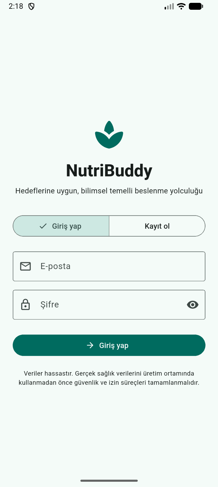
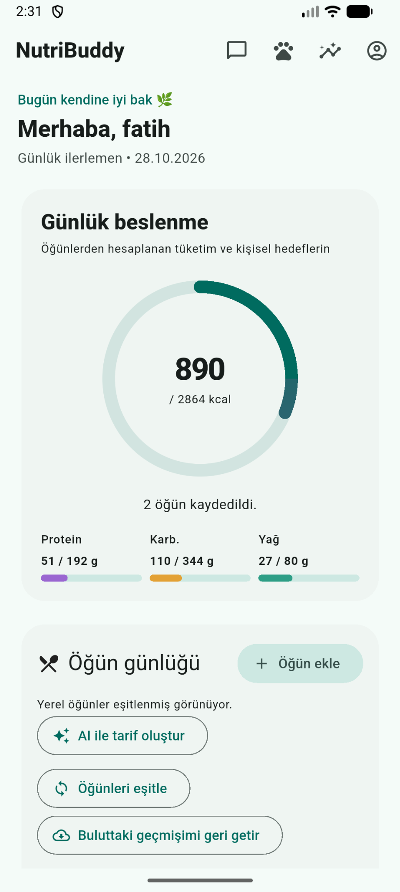
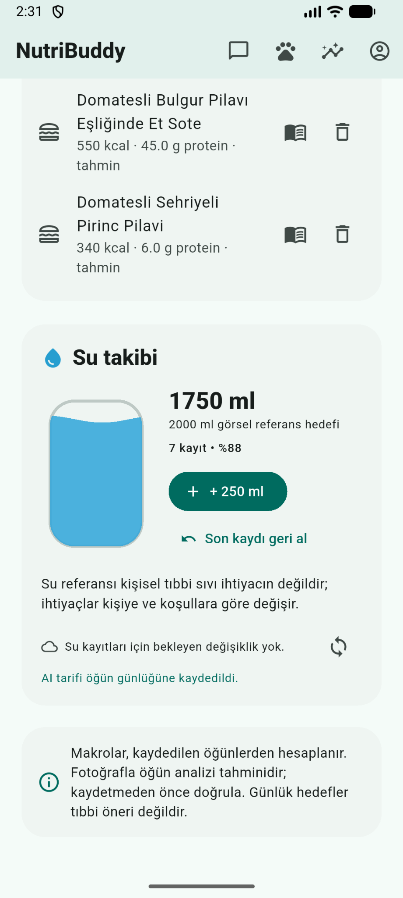
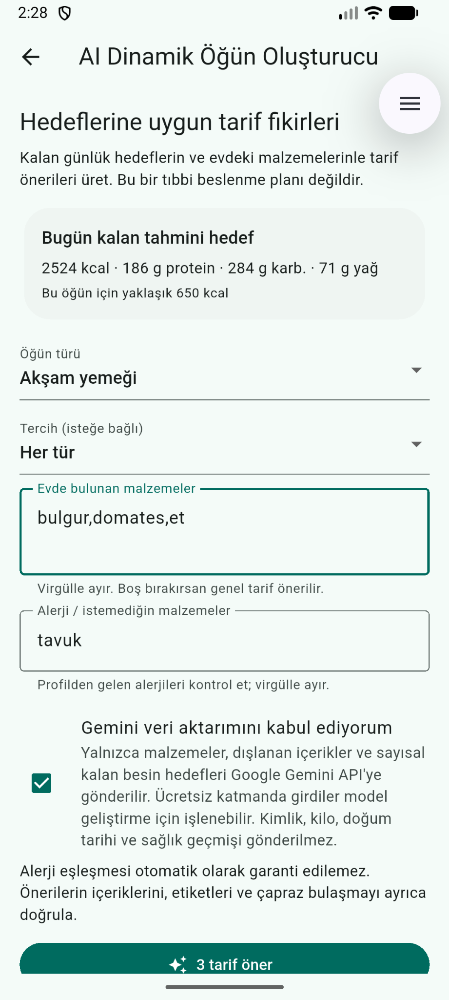
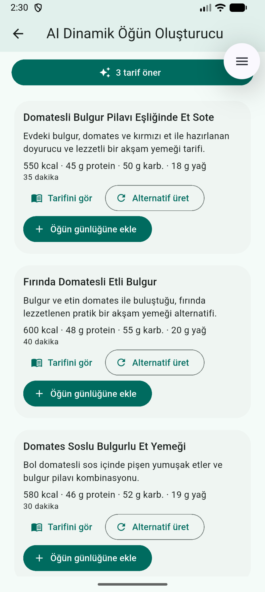
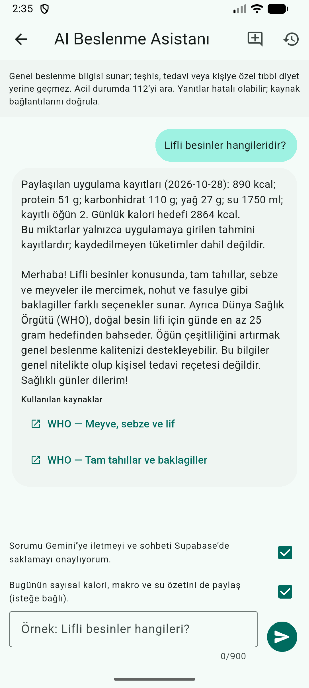
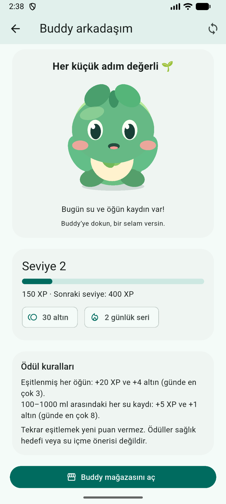
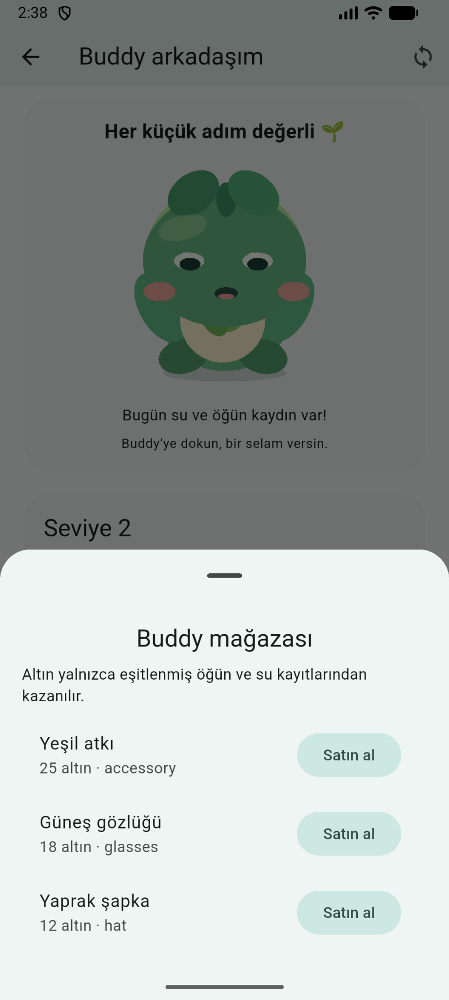
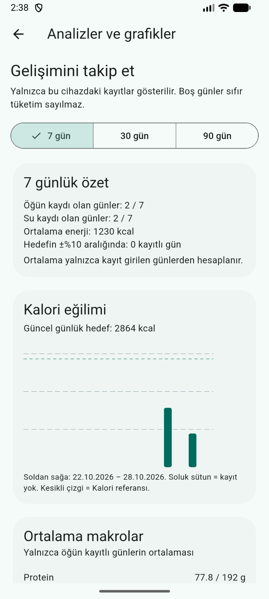

# NutriBuddy

**Languages / Diller:** [English](#english) · [Türkçe](#türkçe)

---

## English

**An AI-assisted nutrition and wellness companion built with Flutter, Supabase, and an offline-first architecture.**

NutriBuddy brings food logging, water tracking, weight trends, personalized meal suggestions, an AI dietitian assistant, and an animated virtual companion into a single mobile experience. The project focuses on practical Flutter engineering, user-scoped data synchronization, testability, and a clear separation between on-device data and cloud services.

> **Project status:** Portfolio / development project. Core workflows have been exercised on an Android emulator; this is **not** a production-ready medical or health-data product. See [Security and limitations](#security-and-limitations).

## Features

| Area | Capabilities |
| --- | --- |
| Accounts and onboarding | Supabase authentication, profile setup, and personalized nutrition targets |
| Nutrition diary | Manual meal logging, daily nutrition summaries, and AI-assisted food-photo analysis |
| Water tracking | Quick 250 mL entries, daily progress, and undo |
| Weight and analytics | Weight entries and progress views |
| Meal suggestions | AI-assisted meal/recipe suggestions with nutrition-related constraints |
| AI dietitian | Retrieval-augmented Q&A with references to indexed knowledge and user context |
| Buddy companion | Animated Rive character, progress, rewards, and inventory/store features |
| Offline-first storage | Local Isar records, pending-mutation tracking, and account-scoped cloud synchronization |

**Connectivity:** Core local recording flows are designed to work offline. Cloud synchronization, authentication requests, and AI-backed features depend on the relevant network services.

## App Screenshots / Uygulama Görselleri

Real screens from the NutriBuddy development build. Publish only with synthetic demo data; the application is not a medical device.

NutriBuddy geliştirme sürümünden gerçek ekran görüntüleri. Yalnızca örnek/test verileri içeren görüntüleri yayımlayın; uygulama tıbbi cihaz değildir.

| **Authentication / Giriş** | **Nutrition Dashboard / Beslenme paneli** | **Water Tracking / Su takibi** |
| --- | --- | --- |
|  |  |  |
| **AI Meal Builder / AI öğün oluşturucu** | **AI Recipes / AI tarifleri** | **AI Dietitian / AI beslenme asistanı** |
|  |  |  |
| **Buddy Companion / Buddy arkadaş** | **Buddy Store / Buddy mağazası** | **Analytics / Analizler** |
|  |  |  |

Additional screens, including onboarding, conversation history, detailed analytics, and the Rive state-machine editor, are available in [`docs/screenshots/`](docs/screenshots/).

Onboarding, sohbet geçmişi, ayrıntılı analizler ve Rive durum makinesi editörü dâhil diğer görüntüler [`docs/screenshots/`](docs/screenshots/) klasöründedir.

## Technology stack

- **Client:** Flutter 3.47+, Dart 3.13+, Material UI
- **State management:** Riverpod
- **Local persistence:** Isar Community
- **Backend:** Supabase Auth, PostgreSQL, Row Level Security (RLS), Edge Functions
- **AI:** Gemini-backed server-side workflows, including image analysis and retrieval-augmented responses
- **Animations:** Rive
- **Quality:** Flutter widget/unit tests, Dart analyzer, SQL validation scripts

## Architecture

The Flutter code is organized by feature, with distinct responsibilities:

```text
lib/
  app/          # Application shell and routing
  core/         # Bootstrap, configuration, database, sync and theme
  features/
    auth/
    onboarding/
    dashboard/
    meals/
    analytics/
    meal_builder/
    ai_dietitian/
    buddy/

supabase/
  functions/    # Server-side AI integrations
  migrations/   # Database schema and security policies
  tests/        # SQL checks

test/           # Dart and Flutter automated tests
assets/rive/    # Buddy animation asset
design/rive/    # Rive design source
```

The code follows a **domain / data / presentation** separation where applicable:

- **Domain:** Models, repository contracts, and business logic.
- **Data:** Local/remote repository implementations, persistence models, and synchronization services.
- **Presentation:** Flutter pages, widgets, and Riverpod providers.

### Offline-first synchronization

Local changes are stored before cloud delivery and tracked as pending mutations. The synchronization layer handles user ownership, remote acknowledgments, and cloud restoration. Data for different signed-in accounts is kept separately; signing out is designed to preserve unsynchronized local changes for the original account.

This is an engineering design and a set of tested workflows, **not** a guarantee that every network failure or conflict scenario has been exhaustively covered.

## Getting started (Windows / Android)

### Prerequisites

- Flutter **3.47+** and Dart **3.13+**
- Android Studio with an Android emulator, or a connected Android device
- A Supabase project configured with the repository's required schema, policies, and Edge Functions for cloud/AI capabilities

### 1. Install dependencies

From the repository root:

```powershell
flutter doctor -v
flutter pub get
```

Generated Dart files are included in this repository. If you change annotated models or providers, regenerate them with:

```powershell
dart run build_runner build --delete-conflicting-outputs
```

### 2. Configure public client settings

```powershell
Copy-Item .env.example.json .env.dev.json
```

Set the following values in `.env.dev.json`:

```json
{
  "SUPABASE_URL": "https://YOUR_PROJECT.supabase.co",
  "SUPABASE_PUBLISHABLE_KEY": "YOUR_SUPABASE_PUBLISHABLE_KEY"
}
```

`.env.dev.json` is excluded from Git. The publishable key is a client-side key, **not** a privileged Supabase service-role key.

### 3. Run on Android

Start an emulator or connect a device, then run:

```powershell
flutter devices
flutter run -d emulator-5554 --dart-define-from-file=.env.dev.json
```

Replace `emulator-5554` with the device ID shown by `flutter devices` if yours differs.

> **Backend setup:** Client configuration alone does not create the database schema or deploy server functions. Review `supabase/migrations/`, `supabase/functions/`, and `supabase/README.md`; apply and validate backend changes in a **development Supabase project** before using the app. AI features require their corresponding server-side configuration and credentials.

## Validation

Run from the repository root:

```powershell
dart format --output=none --set-exit-if-changed lib test
flutter analyze
flutter test
```

**Last locally reported verification (28 October 2026):**

- `flutter analyze`: **No issues found**
- `flutter test`: **60 tests passed**
- Android emulator checks included meal, water, and weight synchronization; offline entry preservation; account switching; and sign-out navigation.

The Windows test runner has also emitted a `rive_native.dll` load warning while the overall test suite passed. Windows native Rive behavior is **not** claimed to be validated by that result.

## Security and limitations

- Supabase tables use user-scoped access controls and RLS. The application includes tests for selected account-isolation and synchronization scenarios; it has **not** undergone an independent security audit.
- **Local Isar data is not encrypted.** Do not enter real sensitive health or medical information into this development build.
- Environment files and signing materials are excluded from version control, but `--dart-define-from-file` does **not** make embedded client values secret. Privileged credentials belong on the server side.
- AI-assisted nutrition estimates and dietitian responses may be inaccurate. They are **not** diagnoses, treatment recommendations, or substitutes for advice from qualified clinicians.
- The app is primarily validated on Android emulator. The presence of iOS, web, and desktop scaffolding does not imply production readiness on those platforms.
- Further work is needed on security hardening, privacy/data lifecycle policies, expanded failure testing, and release preparation.

## Repository notes

- `README.md` describes the current project. Earlier `ADIM*_KURULUM.md` and similar files are retained as development notes, not as required steps for installing the latest version.
- `pubspec.lock` and verified generated Dart sources are committed for reproducible builds.
- Backup files, local secrets, and local databases are excluded via `.gitignore`.

## Disclaimer

NutriBuddy is an educational/portfolio software project. Use synthetic test information only until privacy, security, and release-readiness requirements have been fully addressed.

---

## Türkçe

**Flutter, Supabase ve offline-first (önce yerel kayıt) mimarisiyle geliştirilmiş, yapay zekâ destekli beslenme ve iyi yaşam uygulaması.**

NutriBuddy; öğün kaydı, su takibi, kilo değişimi, kişiselleştirilmiş yemek önerileri, yapay zekâ diyetisyen asistanı ve animasyonlu sanal arkadaşı tek bir mobil deneyimde birleştirir. Projede Flutter mühendisliği, kullanıcı hesabına özel veri senkronizasyonu, test edilebilirlik ve cihazdaki verilerle bulut hizmetleri arasındaki sorumluluk ayrımı ön plandadır.

> **Proje durumu:** Portföy / geliştirme projesi. Temel kullanıcı akışları Android emülatöründe test edilmiştir. Uygulama, **üretim ortamında kullanıma hazır bir tıbbi veya sağlık verisi ürünü değildir**. Ayrıntılar için [Güvenlik ve sınırlamalar](#güvenlik-ve-sınırlamalar) bölümüne bakın.

## Özellikler

| Alan | Yetkinlikler |
| --- | --- |
| Hesaplar ve profil oluşturma | Supabase ile kimlik doğrulama, profil bilgileri ve kişiselleştirilmiş beslenme hedefleri |
| Beslenme günlüğü | Manuel öğün kaydı, günlük beslenme özeti ve yapay zekâ destekli yemek fotoğrafı analizi |
| Su takibi | Tek dokunuşla 250 ml su ekleme, günlük ilerleme ve son kaydı geri alma |
| Kilo ve analizler | Kilo kayıtları ve ilerleme görünümleri |
| Yemek önerileri | Beslenmeyle ilgili kısıtları dikkate alan yapay zekâ destekli yemek ve tarif önerileri |
| Yapay zekâ diyetisyen | İndekslenmiş bilgi kaynaklarından yararlanan, kaynak referanslı ve kullanıcı bağlamını dikkate alan soru-cevap sistemi (RAG) |
| Buddy karakteri | Rive ile animasyonlu karakter, ilerleme, ödül ve envanter/mağaza özellikleri |
| Offline-first depolama | Yerel Isar kayıtları, bekleyen işlem takibi ve kullanıcı hesabına özel bulut senkronizasyonu |

**Bağlantı durumu:** Temel yerel kayıt işlemleri internet olmadan çalışacak şekilde tasarlanmıştır. Bulut eşitlemesi, kimlik doğrulama istekleri ve yapay zekâ özellikleri ilgili ağ hizmetlerine ihtiyaç duyar.

## Kullanılan teknolojiler

- **İstemci:** Flutter 3.47+, Dart 3.13+, Material UI
- **Durum yönetimi:** Riverpod
- **Yerel veri saklama:** Isar Community
- **Arka uç:** Supabase Auth, PostgreSQL, Satır Düzeyinde Güvenlik (RLS), Edge Functions
- **Yapay zekâ:** Gemini ile sunucu tarafında çalışan fotoğraf analizi ve bilgi getirmeli soru-cevap (RAG) iş akışları
- **Animasyonlar:** Rive
- **Kalite:** Flutter widget/birim testleri, Dart analyzer, SQL doğrulama betikleri

## Mimari

Flutter kaynak kodu özellik temelli olarak düzenlenmiştir:

```text
lib/
  app/          # Uygulama çatısı ve yönlendirme
  core/         # Başlatma, yapılandırma, veritabanı, eşitleme, tema
  features/
    auth/
    onboarding/
    dashboard/
    meals/
    analytics/
    meal_builder/
    ai_dietitian/
    buddy/

supabase/
  functions/    # Sunucu tarafındaki yapay zekâ entegrasyonları
  migrations/   # Veritabanı şeması ve güvenlik politikaları
  tests/        # SQL kontrolleri

test/           # Dart ve Flutter otomatik testleri
assets/rive/    # Buddy animasyon dosyası
design/rive/    # Rive tasarım kaynakları
```

Uygun yerlerde **domain / data / presentation** katman ayrımı uygulanır:

- **Domain:** İş modelleri, repository sözleşmeleri ve iş kuralları.
- **Data:** Yerel/uzak repository uygulamaları, kalıcılık modelleri ve senkronizasyon servisleri.
- **Presentation:** Flutter sayfaları, widget'lar ve Riverpod sağlayıcıları.

### Offline-first senkronizasyon

Yerel değişiklikler buluta gönderilmeden önce cihazda saklanır ve bekleyen işlemler olarak takip edilir. Senkronizasyon katmanı kullanıcı sahipliğini, sunucu onaylarını ve buluttan veri geri yüklemeyi ele alır. Farklı hesapların verileri ayrı tutulur; çıkış yapıldığında henüz eşitlenmemiş yerel değişikliklerin ait oldukları hesap için korunması hedeflenir.

Bu açıklama test edilmiş iş akışlarını ve mühendislik tasarımını özetler; **her ağ hatasının veya veri çakışması senaryosunun eksiksiz test edildiği anlamına gelmez.**

## Başlarken (Windows / Android)

### Gereksinimler

- Flutter **3.47+** ve Dart **3.13+**
- Android emülatörü için Android Studio veya bağlı bir Android cihaz
- Bulut ve yapay zekâ özellikleri için gerekli şema, politikalar ve Edge Functions ile yapılandırılmış bir Supabase projesi

### 1. Bağımlılıkları yükleyin

Proje ana klasöründe:

```powershell
flutter doctor -v
flutter pub get
```

Oluşturulmuş Dart dosyaları bu depoda yer alır. Anotasyonlu modelleri veya sağlayıcıları değiştirirseniz kodu yeniden üretin:

```powershell
dart run build_runner build --delete-conflicting-outputs
```

### 2. Herkese açık istemci ayarlarını yapılandırın

```powershell
Copy-Item .env.example.json .env.dev.json
```

`.env.dev.json` dosyasına aşağıdaki değerleri girin:

```json
{
  "SUPABASE_URL": "https://YOUR_PROJECT.supabase.co",
  "SUPABASE_PUBLISHABLE_KEY": "YOUR_SUPABASE_PUBLISHABLE_KEY"
}
```

`.env.dev.json`, Git takibinin dışındadır. Publishable key, istemci tarafı için tasarlanmış bir anahtardır; **ayrıcalıklı Supabase service-role anahtarı değildir.**

### 3. Android'de çalıştırın

Emülatörü başlatın veya cihaz bağlayın; ardından:

```powershell
flutter devices
flutter run -d emulator-5554 --dart-define-from-file=.env.dev.json
```

Cihaz kimliğiniz farklıysa `emulator-5554` yerine `flutter devices` çıktısındaki kimliği kullanın.

> **Arka uç kurulumu:** İstemci ayarlarını girmek, veritabanı şemasını veya sunucu fonksiyonlarını kendiliğinden oluşturmaz. `supabase/migrations/`, `supabase/functions/` ve `supabase/README.md` dosyalarını inceleyin. Arka uç değişikliklerini önce bir **geliştirme Supabase projesine** uygulayıp doğrulayın. Yapay zekâ özellikleri ayrıca ilgili sunucu tarafı yapılandırmalarına ve kimlik bilgilerine ihtiyaç duyar.

## Test ve doğrulama

Proje ana klasöründe çalıştırın:

```powershell
dart format --output=none --set-exit-if-changed lib test
flutter analyze
flutter test
```

**Son bildirilen yerel doğrulama (28 Ekim 2026):**

- `flutter analyze`: **No issues found** (bildirim yok)
- `flutter test`: **60 test başarılı**
- Android emülatöründe öğün, su ve kilo senkronizasyonu; çevrimdışı kayıtların korunması; hesap değişimi ve çıkış yönlendirmesi gibi akışlar denendi.

Windows test çalıştırıcısında `rive_native.dll` yükleme uyarısı görüldü; buna rağmen genel test paketi başarılıydı. Bu sonuç, Rive'ın Windows üzerindeki yerel çalışma davranışının **tamamen doğrulandığı anlamına gelmez.**

## Güvenlik ve sınırlamalar

- Supabase tablolarında kullanıcı hesabına özel erişim kontrolleri ve RLS kullanılmaktadır. Seçilmiş hesap izolasyonu ve senkronizasyon senaryoları test edilmiştir; proje **bağımsız bir güvenlik denetiminden geçmemiştir.**
- **Yerel Isar verileri şifrelenmemektedir.** Bu geliştirme sürümüne gerçek, hassas sağlık veya tıbbi bilgi girmeyin.
- Yerel yapılandırma dosyaları ve imzalama materyalleri Git dışında tutulur. Bununla birlikte `--dart-define-from-file`, istemciye gömülen değerleri gizli hâle getirmez. Ayrıcalıklı kimlik bilgileri sunucu tarafında tutulmalıdır.
- Yapay zekâ destekli beslenme tahminleri ve diyetisyen yanıtları hatalı olabilir. Bunlar **tanı, tedavi önerisi veya yetkin sağlık profesyonellerinin değerlendirmesinin yerine geçmez.**
- Uygulama ağırlıklı olarak Android emülatöründe doğrulanmıştır. iOS, web ve masaüstü proje dosyalarının varlığı, bu platformların üretime hazır olduğu anlamına gelmez.
- Güvenlik güçlendirmesi, gizlilik ve veri yaşam döngüsü politikaları, daha kapsamlı hata testleri ve yayın hazırlıkları üzerinde ek çalışma gereklidir.

## Depo hakkında notlar

- `README.md` projenin güncel durumunu açıklar. Eski `ADIM*_KURULUM.md` ve benzeri dosyalar geliştirme notları olarak tutulmaktadır; güncel sürümün kurulumu için zorunlu adımlar değildir.
- Tekrarlanabilir derlemeler için `pubspec.lock` ve doğrulanmış, oluşturulmuş Dart kaynakları Git geçmişine eklenmiştir.
- Yedek dosyaları, yerel gizli bilgiler ve yerel veritabanları `.gitignore` ile hariç tutulur.

## Sorumluluk reddi

NutriBuddy, eğitim ve portföy amaçlı bir yazılım projesidir. Gizlilik, güvenlik ve yayın hazırlığı gereksinimleri tamamen karşılanana kadar yalnızca **sentetik test verileri** kullanın.
